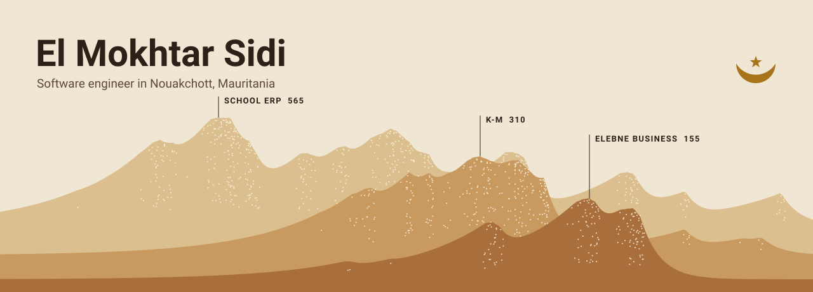

<picture>
  <source media="(prefers-color-scheme: dark)" srcset="assets/dunes-dark.svg">
  
</picture>

Each dune is a project, shaped by how much I committed each day. Every grain of sand is one commit: 1,030 since July 2026, almost all in private repositories.

Software engineer and Computer Systems Development student at SupNum in Nouakchott, Mauritania. I build and run production software used by real people, and I am a co-founder of [Mauri-Dev](https://mauri-dev.online).

**Open to internships and software engineering roles.**

[LinkedIn](https://linkedin.com/in/mokhtar-sidi) · [Kaggle](https://kaggle.com/moktarsidi) · [K-M](https://k-m.study) · [Mauri-Dev](https://mauri-dev.online) · [Mauri-Dev on Facebook](https://www.facebook.com/share/19r22TBEVV/)

## Selected work

The code for these projects is private.

### [K-M](https://k-m.study): online maths learning platform

Team lead. Grew to nearly 1,000 students, with 500 in the first week. Load tested at 1,000 concurrent students with 0% errors and 473 ms p95 page time.

`Next.js` `Supabase` `PostgreSQL` `Cloudflare Workers`

### School ERP: El Ataa El Maarifi School

Team lead. Runs the daily administration of a school of about 1,000 students, including enrollment, payments, grades, payroll and cash.

`NestJS` `Next.js` `Prisma` `PostgreSQL`

### Elebne Business: Ibtikar Network internship, Aug – Oct 2026

Built the GIMTEL integration end to end and connected it to the app, enabling interoperable merchant and wallet-to-wallet payments. Rebuilt core merchant flows and added trusted-device PIN login and biometric unlock.

`React Native` `NestJS` `TypeScript`

## Skills

- **Languages:** TypeScript, JavaScript, Python, SQL
- **Web and mobile:** React, Next.js, React Native
- **Backend:** Node.js, NestJS, FastAPI, Prisma
- **Data:** PostgreSQL, Supabase, MySQL, MongoDB
- **Machine learning:** PyTorch, Scikit-learn, XGBoost, LightGBM
- **Tools:** Git, Docker, Cloudflare Workers, k6
